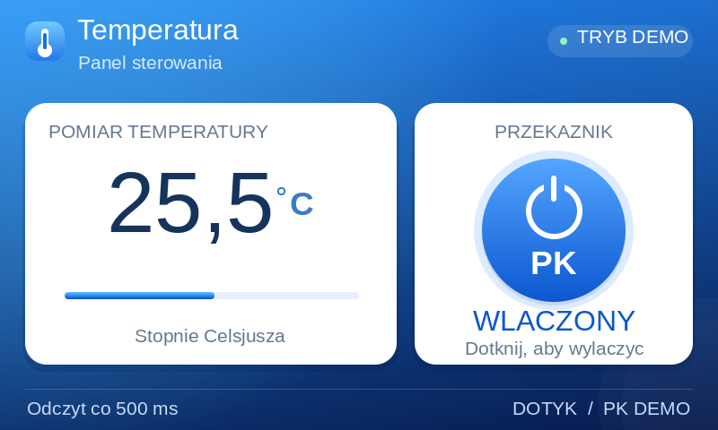

# Panel temperatury i PK 800x480

Pelnoekranowy, niezalezny od Google/sieci widok w stylistyce jasnoniebieskiego
panelu: niebiesko-granatowy gradient, karty, temperatura i dotykowy PK.
Nie jest kopia konkretnego zrzutu Google: nie przekazano takiego wzorca.
Nie przywrocono cofnietej integracji Google ani ESP32.



Podglad powstal z framebufferu kodu C i atrap interfejsu czcionek. Napisy
w podgladzie wykorzystuja Liberation Sans. Na LCD beda to czcionki Arial
wczytane przez istniejace funkcje projektu z karty SD, wiec metryki moga
nieznacznie sie roznic. Podglad nie jest zdjeciem fizycznego LCD.

## Uruchomienie

Pliki implementacji:
- `Application/LCD/Screens/SCREEN_TemperaturePk.c`
- `Application/LCD/Screens/SCREEN_TemperaturePk.h`

Ekran jest podpiety jako numer 7 w istniejacym `SCREEN_ReadPanel()`.
Wywolaj RAZ przy wyborze widoku:

```c
SCREEN_SetNr(7);
```

Nie wywoluj `SCREEN_SetNr(7)` w kazdym obiegu petli. Istniejace zadanie
`vtask_ScreensSelectLCD` wywoluje obsluge ekranu co 20 ms. Zmiana stanu
przycisku nie czeka na polsekundowy odczyt temperatury.
Domyslny ekran startowy pozostaje taki jak w Twoim projekcie.

Warunki: gotowe SDRAM, DMA2D i LCD, dzialajace zadanie dotyku,
wykonana kalibracja oraz czcionki Arial 16, 24, 28 bold i 72 na karcie SD
w formacie i wariancie kolorow obslugiwanym przez `LCD_LoadFont_ChangeColor`.
Wybierz Project -> Clean, potem Build, aby dodac nowy plik C do kompilacji.

## Temperatura

Domyslnie `lcdPanelReadTemperature10 == NULL`: jest to jawny tryb demonstracyjny.
Wartosc zmienia sie co 500 ms wokol 25.5 C (od 24.5 do 26.5 C).

Aby podlaczyc rzeczywista temperature, przypisz wskaznik do szybkiej,
nieblokujacej funkcji odczytu. Funkcja ma zwracac dziesiate czesci stopnia:
`255` oznacza 25.5 C, `-125` oznacza -12.5 C.

```c
static int ReadMyTemperature10(void)
{
    return myTemperature10; /* zastap swoja istniejaca zmienna pomiarowa */
}

/* Przypisz przy wyborze ekranu, przed pierwszym rysowaniem: */
lcdPanelReadTemperature10 = ReadMyTemperature10;
SCREEN_SetNr(7);
```

Obsluga sprawdza HAL_GetTick i wywoluje ten callback co 500 ms. Nie usypia
zadania na 500 ms. Odczyt nastepuje raz po terminie; nie nadrabia zaleglosci
seria wywolan. Jesli pomiar pozostaje identyczny, liczba naturalnie nie zmienia
wartosci. Wskaznik/czujnik nie jest tu powiazany z konkretnym ADC lub GPIO.
Zakres wyswietlania: od -50.0 do 150.0 C; wartosc spoza zakresu daje `--,-`.

## PK i dotyk

Przycisk przelacza `lcdPanelPkDemo` (0/1) po nacisnieciu i zwolnieniu wewnatrz
okraglego przycisku. Przytrzymanie nie powtarza przelaczen. Przesuniecie palca
poza przycisk i zwolnienie anuluje klikniecie. Nacisniecie poza przyciskiem
nie uzbraja klikniecia. Wcisniecie ma osobny, przyciemniony wyglad.

PK jest WYLACZNIE stanem w RAM. Nie ma wywolan HAL_GPIO_WritePin ani sterowania
fizycznym przekaznikiem. Napisy wskazuja demonstracje, nie stan polaczenia z siecia.

## Jedna publiczna funkcja i bezposrednie uzycie

```c
int LCD_TemperaturePkPanel(uint8_t mode,
                          int (*readTemperature10)(void),
                          uint8_t *pkDemo);
```

`LCD_TEMP_ENTER` inicjalizuje i rysuje caly widok, `LCD_TEMP_UPDATE` obsluguje
dotyk i timer, `LCD_TEMP_EXIT` usuwa obszar dotyku panelu. Wywolania powinny
pochodzic z jednego zadania GUI. Nie rysuj jednoczesnie innego ekranu do pLcd.
ENTER resetuje wspolne zasoby ekranu tak jak pozostale widoki projektu.

Kod uzywa Twojego `pLcd` w SDRAM, `LCD_Buffer`, `LCD_Shape`,
`LCD_LoadFont_ChangeColor`, `LCD_StrChangeColor`, `LCD_Show`,
`LCD_DisplayPart` i istniejacego modulu dotyku. Pomocnicze funkcje gradientow
sa statyczne i nie zmieniaja implementacji Twoich istniejacych prymitywow.

## Diagnostyka i sprawdzenia

Obserwuj w debuggerze:
- `lcdPanelPkDemo`: demonstracyjny stan PK;
- `lcdPanelTemperature10`: ostatnia odczytana temperatura, nie zrodlo pomiaru;
- `lcdPanelResult`: 0=OK, 1=klikniecie zmienilo PK, -1=argumenty,
  -2=inna rozdzielczosc niz 800x480, -3=nie udalo sie wczytac czcionki,
  -4=nie udalo sie zarejestrowac dotyku.

Test lokalny: `python3 tests/lcd_temperature_panel_test.py`.
Sprawdza timer 500 ms (takze przepelnienie ticka), gesty dotyku i anulowanie,
ujemna/niepoprawna temperature, blad czcionek oraz granice framebufferu.
Test korzysta z atrap sprzetu i czcionek, nie potwierdza dzialania LCD na plytce.

Sprawdzono kompilacje ARM projektu. Wymagany pozostaje test na fizycznym LCD
z Twoja karta SD, kalibracja dotyku i metrykami plikow czcionek.
Nie zmieniono Drivers, Middlewares, MBEDTLS, LWIP, FATFS ani startup.


## Drugi ekran: ciemny panel ze wzoru

Uruchom raz w zadaniu GUI: `SCREEN_SetNr(8);`.
Funkcja: `LCD_TemperaturePkPanel2(mode, readTemperature10, &pkDemo)`.
Poprzedni ekran 7 pozostaje dostepny.

- `lcdPanel2ReadTemperature10`: wskaznik callbacku czujnika, wynik 991 oznacza 99.1 C.
  NULL uruchamia demonstracje sinusoidalna: poczatkowo 25.5 C,
  odswiezana co 500 ms, zakres -50.0..90.0 C.
  Sinusoida: 15 sekund od minimum do maksimum, pelny okres 30 sekund.
  Wykres dopisuje probki na biezaco. Stala skala: -50 do +90 C.
  Odczyty poza skala sa na wykresie przycinane do granicy; liczba pokazuje odczyt.
- `lcdPanel2PkDemo`: stan RAM, domyslnie ON. Przyciski Wlacz/Wylacz
  ustawiaja stan po puszczeniu palca wewnatrz tego samego przycisku.
- `lcdPanel2Temperature10`: ostatni odczyt; `lcdPanel2Result`: kod wyniku.
- Probkowanie co 500 ms; historia maksymalnie 120 probek (~60 s),
  zaczyna sie pusta, bez fikcyjnych danych. Brak probek nie laczy wykresu.
- Fonty na SD: Arial 9, Arial 14 bold, Arial 36, Arial 16.
- Tryb lokalny DEMO: brak sieci, brak GPIO. Napisy nie deklaruja polaczenia
  z chmura. Proporcje wzoru dopasowano do 800x480; napisy ASCII sa zgodne
  z uzywanym mechanizmem czcionek. To odwzorowanie ukladu, nie kopia pikselowa
  zalaczonego obrazu o innej rozdzielczosci.

Podglad: [panel2-on.png](panel2-on.png). Podglad powstaje z bufora renderera
z zastepczymi czcionkami Liberation Sans; Arial na LCD moze sie roznic.
Test: `python3 tests/lcd_temperature_dashboard_test.py`.
Test hosta sprawdza dotyk, interwal, zawijanie licznika czasu, 120 probek,
bledne temperatury i granice bufora. Ostateczna walidacja wymaga plytki i SD.

Termometr: poziom i kolor od niebieskiego (-50 C), przez zolty (+20 C), do czerwonego (+90 C).
Kontrolka PK: zielona radialna poswiata tylko w stanie ON.

Wykres jest rysowany linia z antyaliasingiem (pokrycie krawedzi, mieszanie z tlem).
Poswiata PK ma zmniejszona intensywnosc: maksymalne alfa 65/255.
